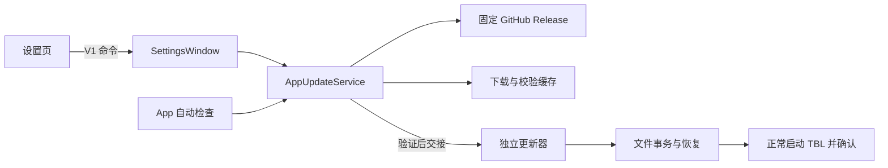

# TaskbarLyrics 应用内更新实施方案

## 1. 状态与决策

- 修订日期：2026-10-31；代码基线：TBL 1.7.6、本地 EGL 当前工作树。
- 状态：分阶段实施中。已接入检查调度、红点、累积日志、下载校验、同版重装、独立更新器、文件事务与启动确认；代码与隔离包验证已开展，真实 Windows 升级／中断恢复矩阵仍待验收。本文替代 2026-08-09 的 Velopack 方案；旧方案可从 Git 历史追溯。
- 目标：参考 EGL 的独立更新器，将 TBL 现有“检查更新 → 打开发布页”扩展为“检查 → 查看说明 → 下载校验 → 重启更新 → 失败恢复”。
- 路线：GitHub Releases + 现有自包含 win-x64 ZIP + 随主程序发布的独立更新器，不接入 Velopack，不迁移安装布局。
- TBL 只有一个正式版本来源，不新增更新通道配置、预览版订阅、云控、远程最低版本、强制更新、公告服务、GitHub Token 或镜像配置。
- 只自动检查，下载和安装均由用户主动触发；保留手动下载后备入口。
- 本文同时记录目标契约与实施验收要求；落地状态及测试证据见工程变更记录。实现阶段不自动提交、公开发布或替换运行中的应用。

## 2. 代码依据与适配结论

### 2.1 EGL 实现参考

以下路径以 `C:/Project/EricGameLauncher` 为根，描述本次实际读取的代码，不表示整体复制：

| 位置 | 当前实现 | TBL 取舍 |
| --- | --- | --- |
| `Core/Updater.cs` | Releases 分页、ETag、短缓存、稳定／最新选择、合并更新说明、云控强更、释放内嵌更新器、管道进度 | 借鉴缓存、隔离更新器和进度交接；固定 TBL 正式目标，分页累积升级区间日志；去掉通道、Token、云控和强更 |
| `Core/UpdatePackageIntegrity.cs` | 要求 `sha256:` + 64 位十六进制，下载后 SHA-256 比较 | 保留失败即停止的完整性门槛；缺少 digest 只允许手动下载 |
| `Components/updater.main/Program.cs` | 临时目录下载，校验后发送 READY，等待主进程退出，替换并启动；写权限不足可提权 | 借鉴校验先于退出；TBL 首版不自动提权，不提供通用命令／批处理／任务执行能力 |
| `Components/updater.main/UpdateTransaction.cs` | staging、backup、原子日志、异常回滚与下次恢复 | 借鉴事务思想，按 TBL 的 ZIP 条目、缓存事务目录和受保护 `Logs/` 重写，不复制 EGL 的 Data／storage.mode 规则 |
| `UserInterface/MainView.xaml.cs` | 更新提示和下载进度，选择 ZIP 资产 | 改为 WebView 设置页；按精确资产名选包，不选“第一个 ZIP” |

EGL 下载器与事务模块值得参考，但并非可以直接嵌入 TBL 的库：其 .NET 10 目标、产品文件名、配置存储、Data 保护规则、控制台和服务依赖都不同。TBL 更新器采用 .NET 8，与主项目 SDK 对齐。

### 2.2 TBL 当前行为

| 位置 | 已确认现状 | 设计影响 |
| --- | --- | --- |
| `TaskbarLyrics.App/UpdateChecker.cs` | latest API 只读 tag 与 html_url；无法解析版本时按字符串比较 | 扩展资产信息，改为严格版本比较；无法解析时不得推断可安装更新 |
| `TaskbarLyrics.App/App.xaml.cs` | 启动约 8 秒后检查；24 小时节流；失败也保存检查时间；按版本去重通知 | 改为每次启动后延迟 5 秒检查、运行期间每 24 小时检查；手动检查不受自动调度阻挡 |
| `TaskbarLyrics.App/SettingsWindow.xaml.cs` | 处理 checkForUpdates 并下发 updateStatus | 改为转发注入服务的命令与快照，不在窗口实现下载事务 |
| `TaskbarLyrics.App/Web/Settings/settings.*` | idle/checking/available/latest/error 与打开发布页 | 增加下载、取消、校验、待重启和恢复状态 |
| `scripts/publish-release.ps1` | `TaskbarLyrics-{version}.zip`；ZIP 内有同名顶层目录；EXE 重命名为 TaskbarLyrics.exe；外带 Web/Assets | 保持包名和布局，安装前必须去掉一个严格匹配的版本目录前缀 |
| `TaskbarLyrics.App/Program.cs`、`SingleInstanceService.cs` | DPI 初始化后获得 LocalAppData 文件锁，以固定管道激活已有实例 | 重启必须等待旧进程和锁释放；新实例不能因旧锁尚在而退出 |
| `TaskbarLyrics.App/StartupService.cs` | HKCU Run 指向当前 EXE | 原目录原文件名替换，无需改注册表、快捷方式或搬迁安装目录 |
| `TaskbarLyrics.App/App.xaml.cs` | 正常退出负责设置、音频、歌词 STA、托盘、组合根等释放 | 更新复用正常退出路径，不能直接 Environment.Exit 或按进程名结束应用 |

用户数据 `%APPDATA%/TaskbarLyrics`、事务缓存与更新器锁均位于 LocalAppData，不在安装目录内；安装目录中的 `Logs/` 受保护。由于 ZIP 是唯一文件清单，事务只备份并替换 ZIP 中实际列出的文件；安装目录中未列入本次 ZIP 的文件保留，避免把无法确认归属的用户文件当成旧发行文件删除。升级过渡时仍识别旧版本留在安装目录 `.tbl-update/` 的事务。

## 3. 产品范围与操作流程

1. 自动检查保持默认开启，每次启动后延迟 5 秒检查，运行期间每 24 小时检查；发现更新时左栏“关于”图标右上角显示小红点，保留不抢焦点的系统通知，不下载、不弹强制更新窗口。
2. 设置页在检测按钮同一行显示结果：无更新显示“当前已是最新版本”，单个递增 Release 显示“已检测到更新”，跨多个 Release 时显示“已检测到累积更新：当前版本->目标版本”。按钮固定顺序为查看更新日志、直接更新、强制重装、检查更新；暂不可用时禁用但不隐藏，强制重装按钮始终显示、更新任务繁忙时禁用。外置更新操作不打开日志浮层；操作期间在按钮行下方显示状态、进度、包大小与取消动作。点击查看日志才打开独立更新窗，浮层继续保留累积日志、进度和更新操作。
3. 下载期间歌词照常运行，显示已下载字节、总量和可取消动作；未知长度使用不定进度。
4. 下载、完整性及包结构验证通过后，应用自动重新验证候选、包及目录状态并启动独立更新器，无需再次确认。
5. 更新器接管后，应用正常退出；用户可在下载与验证期间继续使用应用。
6. 更新器等待准确的主进程退出，事务替换文件，再以原目录的 TaskbarLyrics.exe 重启。
7. 新进程确认启动成功后清理备份；失败则恢复旧文件并尝试启动旧版本，显示可追溯结果。

没有完整更新资产的正式 Release 仍可提示新版本并打开发布页，不能把“不能自动安装”显示成“已是最新”。首版不提供增量包、安装器、后台服务、自动降级、版本选择器或跨架构包分流。

## 4. 发布发现与候选规则

### 4.1 单一来源

固定仓库 `ANYNC/TaskbarLyrics`，沿用 `GET https://api.github.com/repos/ANYNC/TaskbarLyrics/releases/latest`。明确验证 `draft == false`、`prerelease == false`。采用 GitHub latest 的正式发布选择；另按 10.1 节分页获取累积日志，不将发布时间用作版本顺序。

版本只接受可选 v/V 前缀与三个非负整数 `major.minor.patch`；拒绝后缀、四段、嵌入式版本、溢出及格式错误。数值逐段比较，普通升级候选必须严格大于当前版本；强制重装只允许目标等于当前版本。目标低于当前版本时不提供自动降级。当前 InformationalVersion 去除构建元数据后仍不合法时，检查可展示发布信息，但禁用安装。开发构建及非发行目录禁止原地更新。

请求使用专用 HttpClient、User-Agent、明确 Accept 和 API 版本头，遵循系统代理／证书验证。元数据总超时建议 30 秒，支持应用生命周期取消。响应体上限建议 2 MiB；失败区分网络、限流、格式错误、无正式 Release（404），不能统一当作 latest。

### 4.2 缓存、频率和撤回

- 同一进程只有一个检查或下载任务；自动和手动检查复用在途结果。
- 元数据内存缓存建议 2 分钟；手动重查允许跳过短缓存，仍遵守服务端 Retry-After。
- ETag 与响应体成对缓存；无缓存正文的 304 进行一次无条件重试。
- 自动检查固定启用：启动 5 秒后检查，运行期间每 24 小时重复；不提供开关。`LastUpdateCheckUtc` 记录检查尝试；自动失败仍更新检查时间。`LastNotifiedUpdateVersion` 用于系统通知去重，不用于控制红点。旧设置文件中的 `AutoCheckUpdates` 字段会被忽略。
- 自动检查开启时，每次进程启动成功后延迟 5 秒发起首次检查，不因上次启动在 24 小时内检查过而跳过。随后从该次自动检查完成起，每满 24 小时发起下一次，成功或失败都进入下一周期，避免失败重试风暴。手动检查不重置自动周期。
- 应用服务持有单一可取消调度任务，不依赖设置窗口打开。系统休眠恢复后若已到期则补一次，不补跑积压周期；随后从此次完成重新计时。遇在途检查复用结果，遇下载／安装任务延后检查，不取消用户任务、不并发请求。
- 关闭自动检查立即取消待触发调度及仅由自动调度持有的请求，不影响手动检查／下载。运行中重新开启后延迟 5 秒检查，再恢复 24 小时周期；应用退出时取消并释放调度任务。
- 安装前绕过短缓存重新查询固定 release ID 与 asset ID，确认仍公开、非预发布，且版本、资产名、大小和 digest 未变。撤回、删除或同名替换均使候选失效；断网无法复核时暂停安装并保留手动入口。
- GitHub Release 是发布事实来源；没有额外云控撤回表。已开始文件事务后不再访问网络，避免半途被网络失败打断。

### 4.3 资产选择

候选保存 release ID、asset ID、tag、规范化版本、发布页 URL、资产名、下载 URL、size 和 digest，形成不可变快照。

唯一匹配名称为 `TaskbarLyrics-{version}.zip`，要求 uploaded 状态、size > 0、严格有效 SHA-256 digest。匹配零个或多个均禁止应用内安装。GitHub 自动生成的源码包不是更新资产。

发布页只接受 HTTPS、github.com、精确仓库路径。初始下载 URL 限制为该仓库 releases/download 下与候选一致的地址；重定向逐跳验证 HTTPS 及明确允许的 GitHub 下载域（初始实现覆盖 github.com、release-assets.githubusercontent.com），禁止通配子串域名、HTTP 降级和本地地址。域名策略须由发布下载实测验证后固化。

GitHub API 的资产字段包含 digest，规范见 [GitHub Releases REST 文档](https://docs.github.com/en/rest/releases/releases)；其 SHA-256 来源说明见 [GitHub 发布说明](https://github.blog/changelog/2025-06-03-releases-now-expose-digests-for-release-assets/)。旧资产缺失 digest 时不从文件名或未验证文本推断，不跳过校验。

## 5. 组件与职责



| 建议组件 | 责任 |
| --- | --- |
| AppUpdateService / IAppUpdateService | 唯一会话状态、串行命令、候选有效性、取消、状态订阅 |
| GitHubReleaseClient | HTTP、ETag、DTO 和错误分类 |
| UpdatePackageValidator | digest、大小、ZIP 路径、必要文件及目标版本一致性 |
| UpdateProcessLauncher | 释放内嵌更新器、建立受限 IPC、准确进程身份与交接 |
| TaskbarLyrics.Updater（新增项目） | 无界面事务执行、等待退出、日志、回滚及重启握手 |
| UpdateTransaction（可独立测试模块） | 备份日志、应用、提交及幂等恢复 |
| AppCompositionRoot | 创建共享服务、注入 App 与设置页，管理生命周期 |

这些职责位于 App 或专用更新项目，不给 TaskbarLyrics.Core 引入 Windows／更新服务依赖。更新器不引用 WPF、WebView2、音频或完整 App；确需共享的 DTO／验证逻辑用小型共享源或独立轻量程序集，避免复制两套规则。

主程序发行时内嵌可信更新器 payload，运行时释放到系统临时目录的独占会话文件夹，不从网络单独下载可执行更新器。使用 .NET 8 win-x64 自包含单文件，不新增用户运行时要求。发布构建顺序为先更新器、再嵌入并发布主程序，消除循环依赖。

## 6. 状态机与 WebView 契约

| state | 含义 | 用户动作 |
| --- | --- | --- |
| idle | 未检查 | 检查 |
| checking | 请求元数据 | 等待 |
| latest | 无更高正式版本 | 检查；有效同版目标可强制重装 |
| available | 有更新 | 下载、发布页 |
| downloading | 写入临时包 | 取消 |
| verifying | hash／包验证 | 取消 |
| readyToRestart | 已验证完整包，自动启动应用流程 | 自动重启状态、发布页 |
| preparing | 复核候选、启动更新器 | 等待；未交接可安全失败 |
| applying | 更新器接受安装交接 | 关闭过程，不接受重复命令 |
| unsupported | 开发副本／不兼容发行布局 | 发布页 |
| canceled | 下载或校验被主动取消 | 重新下载 |
| error | 可恢复失败 | 按错误阶段重试、发布页 |

`available` 另带 `canDownload` 与 reasonCode，区分“新版本存在但缺少自动更新资产”。关闭设置页只解除订阅，下载由应用服务拥有并继续运行；关闭窗口不能隐式取消。退出整个应用会取消交接前任务，未完成文件不复用。已完成包可留在会话缓存，但下一次进程启动不自动恢复待安装状态，须重新检查和校验；首版不做断点续传。

复用 V1 信封和 `checkForUpdates`、`openExternalLink`、`updateStatus`；新增 `downloadUpdate`、`cancelUpdateDownload`、`applyUpdate`。新增命令 payload 为空，由宿主选择候选；前端不得传入安装目录、任意 URL、digest 或可执行路径。

updateStatus 保留现有 `state/version/currentVersion/url/message`，追加字段，避免随意重命名旧字段：

```json
{
  "state": "available",
  "version": "v1.8.0",
  "currentVersion": "1.7.6",
  "url": "https://github.com/ANYNC/TaskbarLyrics/releases/tag/v1.8.0",
  "message": "发现新版本",
  "operationId": "opaque-session-id",
  "sequence": 1,
  "downloadSizeBytes": 104857600,
  "downloadedBytes": 0,
  "progressPercent": null,
  "releaseNotes": "发布说明纯文本",
  "canDownload": true,
  "canApply": false,
  "canCancel": false,
  "reasonCode": null
}
```

宿主按真实状态验证动作，拒绝重入、迟到回调及未知 payload。sequence 在会话内递增；前端忽略旧快照。字节非负且有上限、百分比为有限 0..100 或 null，最终阶段转换以服务状态为准。WebView 重新加载或重新打开时立即推送最新快照。状态名和字段在协议定义处集中管理，禁止多个 switch 各自推断权限。

## 7. 下载、包格式与完整性

### 7.1 缓存与验证顺序

系统临时目录建议 `%TEMP%/TaskbarLyrics/Updates/{sessionId}/`，会话目录 ACL 限制当前用户与必要系统主体。保存 package.part、package.zip、候选描述、更新器和日志。缓存／日志不进入仓库，不占用用户配置目录。下载使用流式读取，已收字节必须等于 API size，超出立即终止；首版包上限建议 512 MiB。总超时建议 30 分钟、无进展超时 60 秒，均可取消。

成功写入、Flush 并关闭后计算 SHA-256；严格比较后才改名为 package.zip。失败或取消删除本会话半包。SHA-256 是对固定 GitHub 元数据的完整性验证，不等同于独立发布者签名；首版不将采购证书或新安装器作为实施前提。后续如接入 Authenticode，应单独定义发布者策略并验收。

### 7.2 ZIP 与文件布局

沿用单一顶层目录 `TaskbarLyrics-{version}/`，只剥离该层；不搜索任意子目录 EXE，不同时容忍根平铺与多层结构。包根必须有 `TaskbarLyrics.exe` 与 `Web/Settings/settings.html`，其余随包文件按 ZIP 条目安装。不要求也不生成额外清单文件，ZIP 条目本身就是安装文件列表，因此现有发布 ZIP 可以直接作为更新包。

包内文件整体由 ZIP 的 SHA-256 保护，不在包内附加自哈希清单；解压出的目标 EXE 必须与候选版本及产品标识一致，不能只凭存在同名 EXE 判定正确产品。发布目录应明确排除测试、开发依赖、日志、用户数据和临时文件。

解压前完整枚举并验证：Windows PowerShell 5 ZIP 的反斜杠先归一为正斜杠，再禁止绝对路径、盘符、UNC、`..`、NTFS ADS、设备名、尾点尾空格、链接／reparse point、大小写重复项及文件目录冲突；`Logs/`、`.tbl-update/` 等保留路径不得由包指定，必要文件缺失时拒绝安装。落盘路径规范化后仍须包含于目标根；安装路径及中间目录也不得通过 junction/symlink 逃逸。

建议初始限制：10,000 个文件、总展开 2 GiB、单文件 512 MiB；磁盘预检覆盖缓存、展开、备份及安全余量，最终写失败仍必须可回滚。所有限制集中为常量，并以真实发行包验证，不从远端放宽。

## 8. 主进程与更新器交接

1. 点击重启更新后重新确认 Release／asset、完整包 digest 和安装目录；原 EXE 必须与当前 Environment.ProcessPath 一致，目录有效可写，无其他更新事务。
2. 从内嵌资源释放更新器；以 ArgumentList 或受限会话文件传入协议版本、sessionId、目录、候选、PID、进程启动时间与随机管道名，不拼接 shell 命令。
3. 双向命名管道限当前用户，使用随机会话令牌；校验对端进程身份。传入 PID 加启动时间或持有进程句柄，避免 PID 重用。安装目录级独占锁防止多个更新器并发。
4. 更新器独立复验包、路径、当前程序身份、写权限并完成 staging 验证后报告 READY。建议握手超时 30 秒，失败时主应用保持运行。
5. 主应用正常保存设置并按既有退出路径释放音频、WebView2、歌词 STA、系统事件、托盘和单实例锁，随后退出。更新器在收到明确 APPLY 后等待指定主进程真正退出（建议 30 秒）。READY 本身不是覆盖授权；用户在交接前主动退出或管道断开时不得自动应用。
6. 未退出或仍有同目录文件占用则放弃替换并给出重试说明，不遍历杀死同名进程、不结束其他副本、不强杀 Explorer／WebView2 系统进程。
7. 更新期间重启启动竞争需要阻挡：正常启动在进入 WPF 和获取常规单实例前，检查经路径验证且锁仍被存活更新器持有的事务标志，遇到活动事务安全退出；陈旧标志进入恢复流程，不能永久阻止启动。

建议 IPC 为带 protocolVersion、sessionId、sequence、type、payload 的定长上限 JSON 行。消息包括 HELLO、PROGRESS、READY、APPLY、ABORT、ERROR；行长建议 16 KiB，未知版本／字段类型拒绝。更新器作为 WinExe 默认隐藏；退出主程序后的失败使用最小本地化原生提示与日志路径，不依赖已退出的设置页。

首版不自动提权。只读、受保护或网络／不支持事务的目录返回明确错误并提供手动更新；写权限探测文件在 finally 删除。不更改安装目录，不把普通用户 TBL 以管理员身份重启。

## 9. 文件事务、回滚与中断恢复

### 9.1 所有权与目录

下载和更新器位于系统临时目录；持久事务、锁、恢复程序和备份位于 `%LOCALAPPDATA%/TaskbarLyrics/Updates/Transactions/{installationHash}/{transactionId}/`，避免写入只读或便携安装目录。事务复制旧文件到缓存备份并 Flush，再删除旧文件；安装时将缓存中的目标文件复制到安装根并 Flush。跨卷复制不依赖原子移动，文件操作意图先写入 journal，因此崩溃或复制失败会在下次启动时删除半成品并从缓存备份恢复。旧版本安装根 `.tbl-update/` 只作为迁移期恢复来源，不再创建。

事务保存 journal.json、staging、backup 和 result.json。日志包含 schemaVersion、transactionId、产品、规范安装根、旧／新版本、文件操作意图与完成状态、当前阶段；原子写临时日志、Flush(true) 后替换。不得信任外部篡改日志中的绝对路径，所有恢复相对路径重走边界检查。

ZIP 条目是本次更新唯一可信的安装文件集合：包内文件安装或覆盖，并在覆盖前备份；安装目录中未出现在包内的文件保留，因为 TBL 没有安装所有权清单，无法安全判断这些文件是否属于程序。`Logs/` 不纳入替换；事务文件不在安装目录。`%APPDATA%/TaskbarLyrics` 的用户数据不在安装目录，天然不受影响。

首个带内嵌更新器的桥接版本 B 仍需旧用户手动升级到 B；B 起不需要额外清单文件，此后任意后续发行 ZIP 均可直接原地升级。安装范围不依赖历史清单：每次只替换 ZIP 明确列出的文件。旧包中有、新包中没有的文件会留在目录中；若未来需要清理这类旧文件，须先定义可靠的文件所有权规则，不能仅凭缺席于新 ZIP 推断可删除。

### 9.2 提交顺序

1. 取得目录锁并处理未完成事务；失败则停止新事务。
2. 包验证、展开到 staging，复核必要文件、目标 EXE 产品／版本。此时未触碰现有发行文件。
3. 确认主进程已退出及单实例锁可获得，写 Prepared 日志。
4. 每个修改前持久化操作意图，备份原文件，再安装新文件；逐项记录完成。记录原来不存在的文件，回滚只删除本事务创建／替换的文件。
5. ZIP 外的现有文件不修改；受保护目录不修改。
6. 文件集安装完成记 Installed，保留备份，启动新 EXE 并等待启动确认。
7. 新程序在设置可读、组合根及歌词宿主初始化成功后，通过受限握手报告版本和 transactionId；建议等待 60 秒。仅 Process.Start 成功或进程尚未退出不能视为验收。
8. 确认成功后写 Committed，再清理 staging／backup；清理失败保留可识别的已提交日志，下次只做安全清理，不回滚成功版本。

### 9.3 失败与断电

- Prepared 前失败：主程序继续运行；移除本会话缓存即可。
- 替换中失败：逆序移除本次安装文件并恢复备份，`%APPDATA%` 用户数据不受影响；恢复成功尝试启动旧 EXE。
- 新版本启动失败／确认超时：先请求并确认新进程退出，确认文件不再占用后回滚。不能一边运行新程序一边覆盖；无法安全结束时保留 Installed 与备份，提示恢复，不强行覆盖。
- 断电／更新器崩溃：下一次启动在加载应用依赖前检查事务；未提交事务由独立恢复器依据日志幂等回滚。对主 EXE 本身损坏／丢失的情况，事务目录保留可直接启动的 recovery.exe 及使用说明，不能假设损坏主程序一定能执行恢复入口。
- journal 损坏或恢复失败：保留备份和证据，禁止继续自动升级、禁止清理；提示手动恢复路径。
- 文件回滚不意味着用户数据版本自动回滚。第一版不得随更新隐式引入不可逆数据迁移；未来迁移须独立设计兼容读写与备份策略。

## 10. 设置页、文本与错误体验

继续在“关于 → 更新”呈现，遵循 `WebView界面视觉与交互规范.md` 与 `界面本地化与语言设置.md`。简体中文、英文、通用繁体同步更新 text.yaml，不引入在线 UI 依赖。

### 更新提示红点与自动检查文案

- 宿主共享快照追加 `hasUpdate`，仅在已核验的正式目标高于当前版本时为 true；即使该版本缺少自动安装资产，也显示红点并提供发布页入口。最新版的强制重装不显示红点。
- 左栏“关于”导航图标右上角显示小红点，展开和折叠导航均可见，不占用导航文字空间。图标可访问名称／折叠提示同步为“关于，有可用更新”，避免只以颜色表达信息；不额外增加导航菜单项。
- 点击“关于”、阅读累积日志、关闭设置页或关闭自动检查不会清除已确认的红点。更新成功后当前版本不再落后，或下一次成功检查确认无更高版本／目标已撤回时清除；网络失败保留最近一次成功检查结果。
- 新建设置窗口、页面重载及导航折叠立即从共享快照恢复红点，不依赖页面本身再次检查。进程重启不持久化推测红点，首次检查完成后更新。
- 自动检查不提供设置项；在 About 页面说明固定的检查与通知行为，实施时同步三语言：

| 语言 | 设置项说明 |
| --- | --- |
| 简体中文 | 启动 5 秒后检查，运行期间每 24 小时检查一次。有更新时在“关于”图标显示红点，并通过系统通知提醒。 |
| English | Checks 5 seconds after startup and every 24 hours while running. When an update is available, a red dot appears on the About icon and a system notification is shown. |
| 通用繁体 | 啟動 5 秒後檢查，執行期間每 24 小時檢查一次。有更新時在「關於」圖示顯示紅點，並透過系統通知提醒。 |

系统通知继续按目标版本去重，因此设置说明中的通知不表示每 24 小时对同版反复弹出。

更新日志按下文 10.1 实施，包含本次升级区间的累积日志和 EGL 的排版体验；不增加历史日志入口。强制重装按 10.2 实施。

### 10.1 累积更新日志

参考 EGL `Core/Updater.cs` 的 `MergeReleases` 和 `UserInterface/MainView.xaml.cs` 的 `BuildReleaseContentAsync`：目标发布标题在前，目标正文之后按版本倒序追加其他新版本，使用分隔线、发布名称标题和正文。保留 Markdown 排版及 body_html 优先、body 转换后备的来源选择，不复制通道注释、“历史更新记录”按钮、历史弹层和历史浏览功能。

- latest API 仍确定唯一安装目标；另请求 `GET /repos/ANYNC/TaskbarLyrics/releases?per_page=100` 并按 Link 分页，生成 `当前版本 < release.version <= 目标版本` 的正式发布列表。没有更新时展示当前版本对应 Release 的日志；若 latest 低于当前版本，则从分页列表定位当前版本。此处补充第 4.1 节的发现流程：分页仅服务日志展示，不改变安装目标，不选择预发布或草稿。
- 例如从 1.7.3 升到 1.7.6，依次展示 1.7.6、1.7.5、1.7.4，不包含 1.7.3 及更早日志。只有一个新版本时只显示目标正文；已是最新版及同版重装时显示目标自身日志。
- API 时间顺序不等于版本顺序，不能因为某页出现旧版本就提前结束。跨页按 release ID 去重后按规范版本排序；同版本多个正式发布标记歧义，不随意重复拼接。资产始终来自固定目标 Release。
- 每个版本优先使用 body_html，缺少时从 body Markdown 转换。保留标题、段落、列表、强调、引用、代码块、表格和安全链接。标题进行 HTML 编码，正文无论来源均先净化；转换失败降级纯文本。
- 禁止脚本、事件属性、iframe、表单和访问宿主桥接；图片允许 HTTPS 资源，移除事件、任意样式和非 HTTPS 源，并使用 no-referrer。日志在隔离容器展示，链接交由宿主验证后打开，不得替换设置页。复用现有 WebView，不直接搬入 EGL 的 WinUI 控件或尺寸。
- 每页 ETag 与正文成对缓存。建议单页上限 2 MiB、最多 20 页、累积正文上限 512 KiB；达到上限、分页失败或正文截断时明确提示“累积日志未完整加载”，允许重试并保留发布页入口。不得将部分结果标成完整；HTML 截断必须保持结构完整。
- updateStatus 追加 `releaseNotesHtml`（展示前在网页隔离容器中净化的 HTML）和 `notesComplete`，保留 `releaseNotes` 为累积 Markdown 源文本／纯文本后备。此规则替代上方 JSON 示例的“发布说明纯文本”语义。日志加载失败不改变已验证资产的真实性，也不阻断安全下载安装。
- 不新增历史日志命令、路由、弹层或全版本持久日志库。读取旧 Release 元数据仅为累积本次升级区间。

#### 日志展示与已验收行为

- 使用从 EGL WebViewStyles.MarkdownCss 提取的 GitHub Markdown 样式，随包本地加载，仅作用于日志容器，附上游许可。
- 更新窗内的累积更新说明固定展开，不提供折叠控件；无可显示内容时隐藏日志区域。
- GitHub HTML 的临时签名图片地址，按附件 GUID 与原始正文中的稳定附件地址精确对应；图片及原图链接一起修复，不按序号配对。图片保留替代文本与有效尺寸，随容器缩放并懒加载；HTML 优先和 Markdown 后备都支持图片。
- 正常更新区不展示重复状态、静态包大小或开发副本技术解释；最新版提供检查与强制重装，新版以更新为主要动作，手动下载入口在需要后备路径时显示。
- 2026-10-31 用户手测确认当前显示正常。该验收覆盖界面显示，安装、回滚和异常中断矩阵仍按本文后续要求独立验收。
### 10.2 强制重装按钮

设置页强制重装按钮固定显示，避免检查结果变化时闪烁。点击后宿主按当前安装版本调用 Release tag API 精确定位正式 Release，校验版本相同、包名、uploaded 状态、大小和 SHA-256 digest；不依赖 latest 恰好等于当前版本，也不降级到其他版本。

“强制”只表示允许同版覆盖程序文件，不跳过 SHA-256、权限、候选复核、备份或启动确认。点击后重新完整下载，不复用已有待安装包；验证完成后自动启动更新并重启，不额外叠加确认弹窗。

新增空 payload 命令 `reinstallUpdate`，由宿主选择当前已安装版本的正式目标，进入既有 downloading／verifying／readyToRestart 流程。快照追加 `canReinstall` 与 `operationKind: upgrade | reinstall`，IPC、事务日志、重试和结果均保留操作类型。不能信任前端版本或因版本相同直接判定事务成功；同版仍执行实际替换和启动确认。

重装继续保护 `%APPDATA%` 用户数据和安装目录中的 `Logs/`；事务备份及恢复程序保存在 LocalAppData。安装目录按 ZIP 条目替换。若目录结构异常（例如受保护目录名被文件占用或缺少目标 EXE），不扫描猜测删除，转为手动修复；强制重装不承担任意损坏目录的恢复能力。

下载进度最多约每 200ms 更新一次，读屏播报进一步节流；使用原生 progress 或完整 ARIA 值。不重建输入／按钮节点导致焦点丢失，动作切换后合理恢复焦点；验证窄窗口、三语言、系统文字放大、减少动态效果和高对比度。

稳定错误码建议：Network、RateLimited、InvalidRelease、AssetUnavailable、MissingDigest、HashMismatch、InvalidPackage、InsufficientSpace、AccessDenied、FileInUse、UpdaterHandshakeFailed、MainExitTimeout、CandidateChanged、ApplyFailed、RollbackFailed、RestartFailed、RecoveryRequired。用户文案由本地映射，异常详情进入日志；message 不接受服务端任意 HTML。取消单独标记，不报更新失败。

错误后的重试按阶段选择：元数据错误重新检查；下载错误重新下载；校验失败丢弃包；交接前错误保留已校验包但安装前重验；恢复失败先恢复再允许新更新。日志带 sessionId／transactionId、版本、阶段、字节与错误码，敏感路径只保留排查必要信息。

## 11. 发布脚本改造与过渡

1. 保留 `publish-release.ps1` 的 x.y.z 版本输入、win-x64、自包含、TaskbarLyrics.exe 名称和 ZIP 顶层目录。
2. 在隔离构建目录先发布更新器，再嵌入主程序；无开发机绝对路径和额外运行时依赖。
3. 直接用更新器的包校验入口验证最终 ZIP 的顶层目录、路径、必要文件和目标 EXE 产品／版本，再生成 ZIP SHA-256 供维护者比对；不生成或附加额外清单文件。
4. 发布时上传 ZIP 后读取 GitHub 资产 size/digest，与本地 hash 比对。只有资产完整、校验一致才公开为 latest；这是待建立发布验收步骤，不声称当前脚本已自动上传或验证。
5. 同版本资产发布后不覆盖；有问题撤回并发布更高修复版本。客户端复核会阻止被撤回候选安装，不强制现有用户升级，也不自动降级。
6. B 为首个带内嵌更新器的版本，具体版本号由实际发布时填写，不提前假定 1.8.0。旧用户手动覆盖到 B 后可在原目录继续升级；B 起的发行 ZIP 保持现有布局，不需要额外清单。不要停止传统 ZIP。
7. 成功更新保持 EXE 路径，因此现有开机启动项和快捷方式继续有效；升级失败不能自行重写 HKCU Run。

旧文档中的 Setup／Portable 双发布、Velopack 引导／稳定启动器、强制代码签名上线门槛及安装布局迁移均不再是本方案要求。

## 12. 分阶段实施与验收

| 阶段 | 交付 | 必须通过 |
| --- | --- | --- |
| U0 发现服务 | 严格版本、latest DTO、分页累积日志、精确资产、缓存和共享状态；现有检查入口接入 | 正常／异常／取消／并发／ETag／限流测试；保留旧设置 |
| U1 包基础 | 独立更新器构建与嵌入、发布结构验证 | 真实发行 ZIP 通过包校验；开发资源不入包；无需额外运行时 |
| U2 下载与协议 | 流式下载、同版强制重装、digest、ZIP 安全、累积日志排版及设置页三语言 | 不完整包不能 ready；取消和迟到回调、窗口重开、V1 非法消息测试 |
| U3 事务与恢复 | IPC、正常退出、备份日志、启动确认、断电恢复 | 故障注入覆盖每个文件操作与日志边界；成功与失败重启验证 |
| U4 端到端验收 | 从桥接 B 到更高版本、发布文档与故障说明 | 完整测试、零警告构建、真实 Windows 升级和恢复矩阵 |

各阶段可在测试中启用，但 U3/U4 未通过前生产 UI 不开放下载安装。文档阶段完成不代表更新功能完成；工程变更记录在实现阶段验收后再写实际行为及验证证据。

### 自动验证矩阵

- 调度与红点：启动满 5 秒才检查、不受历史检查时间阻挡、运行满 24 小时重复、失败后下一周期、休眠恢复只补一次、开关与退出取消、手动检查不重置周期、并发复用／下载延后；新版显示红点、同版重装无红点、缺资产仍提示、阅读不清除、失败保留、撤回清除、窗口重开／折叠恢复、三语言文案及可访问名称。
- 版本：v/V、同版、较旧、10 与 9 的数值比较、非法／超长／溢出、预发布、无 latest。
- 重装：同版按钮、新版升级入口、远端旧版拒绝、重新下载、同版文件替换、失败恢复及用户数据保留。
- 日志：跨版本倒序累积、排除当前及更旧／预发布、同版正文、分页乱序／重复／失败、截断提示、HTML 优先及 Markdown 后备、内容净化、无历史入口。
- HTTP：超时、取消、代理错误、403/429、404、304 缓存缺失、未知字段、正文超限、错误 URL／跳转、撤回／同名换包。
- 资产：缺包、多匹配、源码 ZIP、缺 digest、错误 hash、大小不符、截断、磁盘不足。
- ZIP：正确版本前缀、错误版本根、多根、路径穿越、大小写冲突、ADS、保留名称、链接、膨胀包、文件目录冲突、必需文件缺失、错误产品和版本。
- 事务：每次目标文件备份／安装／日志写入故障，丢电重放、恢复重入、损坏日志、清理失败、受保护目录与 ZIP 外文件保留。
- 进程：错误身份、PID 重用、握手超时、主进程不退出、旧锁释放延迟、更新时重复启动、新版本不确认、回滚时文件占用。
- Web：状态动作、双击、未知 V1、非法 payload、进度边界、重开设置、三语言与文本安全。

### Windows 手工矩阵

至少验证可写普通目录、中文／空格／长路径、只读／受保护目录、杀软锁定、缓存与安装目录分卷、磁盘满、更新中关机模拟、多显示器歌词窗口与音频活动下正常退出；新／旧 EXE 和第三方同名进程必须不误杀。保留设置、歌词缓存、歌曲映射、单曲偏移、日志、用户数据、开机启动及快捷方式。

使用隔离测试发布副本与独立测试用户数据；不覆盖正在使用的开发仓库或真实用户数据。按仓库规范执行 Full 验证、零警告解决方案构建、发行资产检查和 git diff --check；故障注入使用测试 ZIP／本地传输替身，不依赖网络上发布坏包。

## 13. 完成定义与实施前检查

应用内更新只有在“检查、累积日志、升级／强制重装、下载、校验、正常退出、替换、启动确认、回滚、中断恢复”全部通过后才算完成。发布页后备入口始终可用，不满足安装条件必须清楚展示原因。

实施时先以真实发行包确定包大小限制和必要文件集合，确认独立更新器嵌入构建与恢复入口不循环依赖，完成 GitHub 下载域实测，再固化协议版本及错误码。上述是工程验收事项，不需要先建立更新通道、云控平台或新的安装器。
